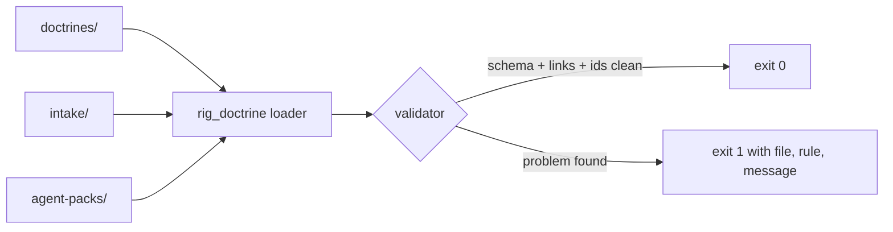

# doctrine


[](https://github.com/mrodgersjs-web/doctrine/actions/workflows/ci.yml)
[](LICENSE)
[](https://www.python.org/)

Operating rules that agents load before they act: proof standards, approval
gates, and coding-agent playbook constraints, in markdown with a validator.

## Why this exists

Agent teams drift when the rules live only in chat history. This repository is
the law layer for the studio fleet: what must be true before tools run, what
counts as done, and what is forbidden on public surfaces. The `rig-doctrine`
package makes that corpus checkable, so a broken link or a malformed intake
record fails CI instead of quietly rotting.

## Quickstart

```bash
pip install -e '.[dev]'
rig-doctrine validate                    # whole corpus, exit 0 when clean
rig-doctrine list --kind doctrine        # 15 doctrine texts + catalog
rig-doctrine show gate-d                 # one record, sections + body
pytest -q                                # 29 tests
```

## Usage

Three commands cover the corpus (`--json` on each for machine output):

```text
$ rig-doctrine list --kind agent-pack
grill-me-agent-pack                      agent-pack  RIG Grill Me Pro Knowledge Extraction Agent Pack
higgsfield-agent-pack                    agent-pack  Higgsfield Cinematic OS Agent Pack
mtp-agent-pack                           agent-pack  MTP Speculative Decoding Agent Pack
phronema-agent-pack                      agent-pack  Phronema Compiled Intelligence Agent Pack
taste-agent-pack                         agent-pack  RIG Design Studio Taste Agent Pack

$ rig-doctrine validate
checked 31 record(s)
OK
```

Files are grouped by directory: `doctrines/` is promoted doctrine, `intake/`
is unpromoted source material with front matter (`title`, `source`, `received`,
`status`, `promoted_to`), and `agent-packs/` holds compact agent instructions.
Record ids are the file stems lowercased, so `doctrines/GATE-D.md` is `gate-d`.

## How it works



Per-kind rules: doctrine files need exactly one level-1 heading and at least
one level-2 section; intake files need the five front-matter keys and a known
`status`; agent packs need a heading and a section; every local markdown link
must resolve; ids must be unique. Full rules: [docs/architecture.md](docs/architecture.md).

## What it proves

Checks a reader can run:

1. `rig-doctrine validate` - the whole corpus satisfies the schema and has no broken links.
2. `pytest -q` - every validation rule fires on a crafted input, and the bundled corpus passes in `tests/test_validator.py`.
3. `python examples/validate_repo.py` - the same check as a standalone script (run by CI).

## Project layout

```
src/rig_doctrine/   loader, schema validator, CLI
doctrines/          15 promoted doctrine texts + catalog
intake/             10 unpromoted source records
agent-packs/        5 compact agent instruction packs
tests/              unit tests plus a corpus-wide schema check
examples/           runnable validation example
docs/               architecture, usage depth, public boundary
```

## Development

```bash
pip install -e '.[dev]'
ruff check .
pytest -q --cov=rig_doctrine
```

## Contributing

See [CONTRIBUTING.md](CONTRIBUTING.md). Doctrine is merged because it improves
agent behavior and can be verified, not because it sounds good.

## Security

See [SECURITY.md](SECURITY.md). Report issues to security@rodgersintelligence.com,
not in a public issue.

## License

MIT. See [LICENSE](LICENSE).

Deeper material: [usage and promotion levels](docs/usage.md) (maturity ladder,
minimum doctrine pack contract, agent loading order). The original planning
notes are kept for context in [docs/internal.md](docs/internal.md); where they
describe an external baseline, that baseline is not verifiable from this
repository.

Built by Mike Rodgers · [rodgersintelligence.com](https://rodgersintelligence.com/)
